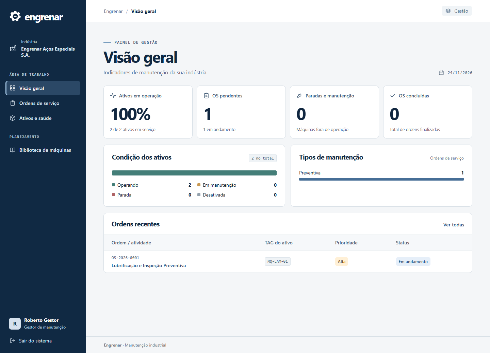

# Engrenar — Painel de manutenção industrial

O Engrenar é uma aplicação web para cadastrar máquinas e acompanhar suas ordens de serviço (OS). A equipe de gestão consulta os indicadores da fábrica, instala máquinas a partir de modelos da biblioteca e distribui as ordens. A equipe de operação consulta os ativos e registra o andamento das atividades sob sua responsabilidade.

**Autora:** Sicília N. Z. E. Luz · Trabalho individual de Programação Orientada a Objetos.

## Aplicação em funcionamento



Com os dados de exemplo, a seção **Ordens recentes** mostra a OS `OS-2026-0001`, vinculada ao laminador `MQ-LAM-01`. Abra a ordem para consultar sua descrição, prioridade e responsável.

## Tecnologias e organização do código

| Componente | Tecnologia | Onde encontrar |
| --- | --- | --- |
| Interface web | PHP 8.1+, HTML, CSS e JavaScript. O PHP gerencia o login e envia as ações do usuário à API Java. | [Controladores PHP](engrenar-painel/app/controllers), [telas](engrenar-painel/views) e [arquivos públicos](engrenar-painel/public) |
| Regras de negócio | Java 17. As classes `Maquina`, `OrdemServico` e `Usuario` representam as entidades do sistema. | [Model](engrenar-painel/backend/src/Model) e [Controller](engrenar-painel/backend/src/Controller) |
| Persistência | MySQL 8. Os DAOs executam consultas e alterações via JDBC. | [DAO](engrenar-painel/backend/src/DAO), [fábrica de conexões](engrenar-painel/backend/src/Util/ConnectionFactory.java) e [script do banco](engrenar-painel/database/banco1.sql) |
| Bibliotecas Java | MySQL Connector/J 26.7.0 conecta o backend ao banco. Gson 2.13.2 lê e escreve as mensagens JSON da API. | [JARs e licenças](engrenar-painel/backend/lib) |

## Instalação e execução no Windows

### 1. Preparar o ambiente

Instale o Git, o **JDK 17 ou superior**, o **MySQL Server 8** com o **MySQL Workbench** e o **PHP 8.1 ou superior** com as extensões `curl` e `mbstring` habilitadas. Deixe o serviço MySQL em execução. Os comandos `git`, `java` e `javac` devem estar disponíveis no PowerShell. O inicializador procura o PHP no PATH e também em `C:\xampp\php\php.exe`.

Clone o repositório e entre na pasta da aplicação. Execute os próximos passos a partir dessa pasta.

```powershell
git clone https://github.com/Siciliazoldan/trabalho_poo.git
cd .\trabalho_poo\engrenar-painel
```

### 2. Criar o banco e carregar os exemplos

**O script começa com `DROP DATABASE IF EXISTS engrenar` e apaga qualquer banco com esse nome na conexão selecionada.** Para uma instalação nova, use uma instância de desenvolvimento onde esse banco possa ser recriado.

1. No MySQL Workbench, abra a conexão local (por padrão, `127.0.0.1:3306`) e use **File → Open SQL Script** para abrir [banco1.sql](engrenar-painel/database/banco1.sql).
2. Selecione desde a primeira linha até o fim do primeiro `INSERT INTO mov_estoque`, imediatamente antes do comentário `-- TESTES-------------`. Clique no raio **Execute the selected portion of the script**. Esse trecho cria as 21 tabelas e carrega quatro usuários, duas máquinas e uma ordem de serviço.
3. Em outra aba de consulta, execute o comando abaixo para conferir o vínculo entre a máquina e a OS.

```sql
SELECT o.numero, m.tag, o.status
FROM engrenar.ordem_servico AS o
JOIN engrenar.maquina AS m ON m.id_maquina = o.id_maquina;
```

O resultado esperado é `OS-2026-0001 | MQ-LAM-01 | em_andamento`. A seção final do arquivo reúne testes e cadastros adicionais. Se você executá-la após a carga inicial, o MySQL rejeitará o preço negativo da peça (erro 3819) e o cadastro de indústria com CNPJ repetido (erro 1062).

### 3. Definir a senha do primeiro acesso

De volta ao PowerShell, execute o utilitário de senha do painel.

```powershell
powershell.exe -NoProfile -ExecutionPolicy RemoteSigned -File .\iniciar.ps1 -DefinirSenha
```

1. Informe o usuário e a senha do **MySQL** que têm acesso ao banco criado.
2. Quando o programa pedir o e-mail do Engrenar, digite `roberto.engenheiro@engrenar.invalid`. Essa conta tem acesso ao painel de gestão.
3. Escolha e confirme uma senha de 8 a 72 bytes para essa **conta do painel**. O utilitário grava o hash bcrypt no banco.

### 4. Iniciar a aplicação

Na mesma pasta, execute o inicializador em modo local e informe as credenciais do MySQL quando solicitado.

```powershell
powershell.exe -NoProfile -ExecutionPolicy RemoteSigned -File .\iniciar.ps1
```

O script compila o backend, inicia a API Java na porta `8781` e a interface PHP na porta `8780`. Mantenha o terminal aberto. No navegador, entre com a matrícula **1002** e a senha do painel definida no passo anterior. [Abrir o Engrenar localmente](http://127.0.0.1:8780/)

Para conferir a instalação, abra **Ativos e saúde**, localize a TAG `MQ-LAM-01` e consulte as ordens vinculadas. Para encerrar a aplicação, pressione **Ctrl+C** no terminal do inicializador.

## Transparência de IA

A inteligência artificial auxiliou na adaptação do backend Java ao domínio de manutenção industrial, na integração das telas PHP com os DAOs via API e na criação dos formulários de cadastro e edição. Também foi usada para preparar os scripts de execução, verificar o login e as consultas de ativos e ordens em um banco de teste e organizar este README.
